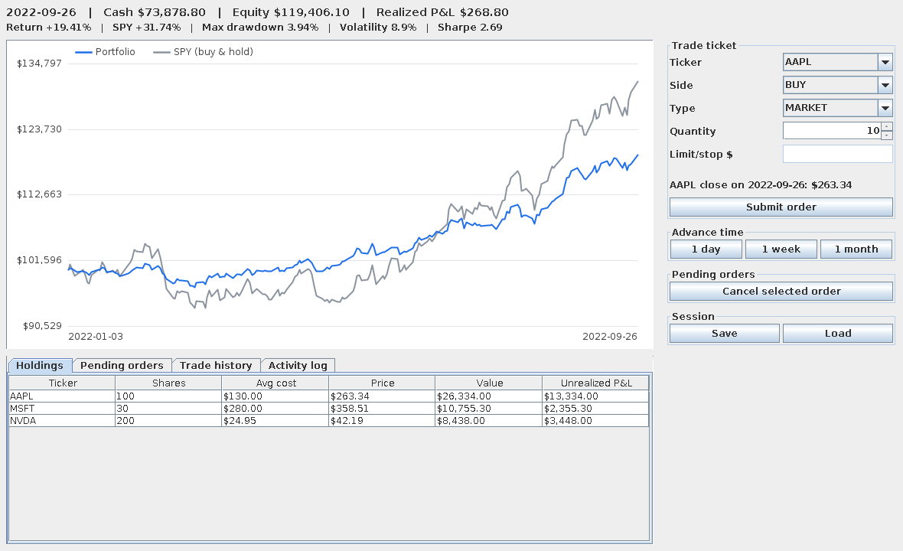

# Portfolio Simulator

A desktop app for practicing trading against historical prices. You pick a start date, place
market / limit / stop orders, step the clock forward day by day, and compare your portfolio with a
buy-and-hold benchmark (SPY by default). Built in plain Java 17 with a Swing GUI, JUnit 5 tests,
Maven, and GitHub Actions CI. There is no web server and no database.



## Features

- **Historical replay.** The simulation date only moves forward when you press *1 day / 1 week / 1 month*.
- **Order types.** Market orders fill immediately at that day's close. Limit and stop orders wait as
  pending orders and fill on the first later day whose close triggers them.
- **Portfolio accounting.** Cash, share positions, average-cost basis, realized and unrealized P&L.
- **Analytics.** Total return, max drawdown, annualized volatility, and Sharpe ratio (0% risk-free rate),
  plus a chart of your equity curve against a buy-and-hold benchmark.
- **Save / load.** Sessions are saved as a small text file and the equity curve is rebuilt on load.

## Run it

Requires Java 17+ and Maven.

```bash
mvn package                          # compiles, runs the tests, builds target/portfolio-simulator.jar
java -jar target/portfolio-simulator.jar
```

Options:

```
--data DIR          folder of price CSVs            (default: data/prices)
--cash AMOUNT       starting cash                   (default: 100000)
--start YYYY-MM-DD  first simulated day             (default: first day in the data)
--benchmark TICKER  buy-and-hold comparison ticker  (default: SPY)
```

## Using real price data

The repo ships with **synthetic** prices (random walks, not real market data) so the app runs out of the
box. The window title says `SYNTHETIC SAMPLE DATA` while `data/prices/SYNTHETIC_DATA.txt` exists.

To use real history, run the downloader (needs Python 3 and an internet connection):

```bash
pip install yfinance
python scripts/fetch_prices.py     # 13 tickers incl. SPY, 2022-01-03 to 2025-12-31 (options: --tickers, --start, --end)
```

It writes `data/prices/<TICKER>.csv` (split- and dividend-adjusted closes) and removes the synthetic files.
Or do it by hand: download daily history from Yahoo Finance for each ticker, save it as
`data/prices/<TICKER>.csv`, include `SPY.csv` for the benchmark, and delete `data/prices/SYNTHETIC_DATA.txt`.

The loader reads the `Date` and `Close` columns by name, so Yahoo's default format works as-is.

## Design

```
portfoliosim
|-- model       Order, Transaction, Portfolio, MarketData, EquityPoint (no I/O, no Swing)
|-- engine      TradingEngine: order submission, day-by-day replay, fill rules
|-- analytics   PerformanceAnalyzer: return, drawdown, volatility, Sharpe, benchmark curve
|-- data        CsvPriceLoader, SaveFile, SampleDataGenerator
`-- ui          AppPanel, EquityChartPanel, MainFrame (Swing)
```

The model, engine, and analytics packages know nothing about Swing, which keeps them easy to unit test.

### Fill rules (close-only data)

Only daily closes are available, so all fills happen at the close:

| Order | Fills when the close is... |
|-------|----------------------------|
| Limit buy / limit sell | at or below / at or above the limit |
| Stop sell (stop-loss) / stop buy | at or below / at or above the stop |

The fill price is the close itself, not the limit or stop price, so a stop-loss can fill below its stop
(a gap down), just as in real markets.

### Known limitations

- No intraday prices, so no partial fills, slippage, or bid/ask spread.
- No commissions, taxes, dividends, or splits (use split-adjusted data).
- Pending buy orders do not reserve cash; if the cash is gone when the order triggers, it is rejected.
- Sharpe ratio assumes a 0% risk-free rate.

## Tests

`mvn test` runs the JUnit 5 suite (order triggers, portfolio accounting, engine fills, analytics against
hand-computed values, CSV parsing, and save/load round trips).
